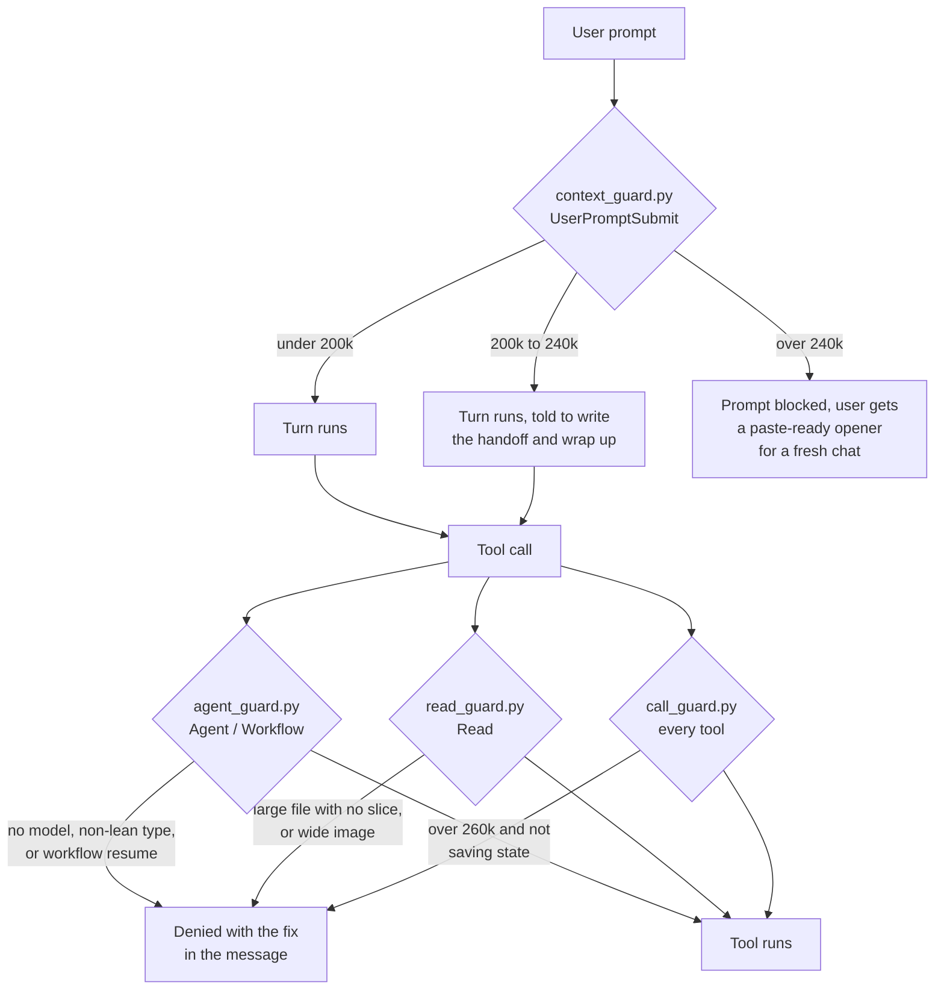

# Claude Code Token Guard

Four small hooks and nine cost-tiered subagent types that stop a Claude Code session, and the agents it spawns, from spending far more tokens than the work needs.

**Plain-words write-up:** [Spending rules an AI can’t skip](https://ryanwisth.github.io/token-guard.html)

## Why it exists

An AI coding agent re-reads its whole conversation on every tool call. Three habits make that expensive without making the work better:

- **Long sessions.** A chat at 250k tokens of context pays 250k on every call, including the call that renames a variable.
- **Unpinned subagents.** A spawned agent with no model named inherits the session's model, so one "fan out 20 agents" step runs 20 copies of the most expensive model.
- **Heavy tool results.** One whole-file read of a large log, or one full-size screenshot, stays in context for every later call.

Written rules in a prompt did not hold: the agent agreed with them and broke them an hour later. These hooks enforce the rules at the tool call, where the agent cannot forget them. Each one was added after measuring a specific leak in real session logs (the measuring side is in [claude-code-token-scan](https://github.com/ryanwisth/claude-code-token-scan)).

## How it works



Every denial message says what to do instead, so the agent corrects itself on the next call without the user stepping in.

## The hooks

| Hook | Event | What it stops | What it allows |
|---|---|---|---|
| `context_guard.py` | UserPromptSubmit | Prompts sent into a chat past 240k tokens. Past 200k it adds a reminder to write the handoff file. | A prompt starting with `keep:` passes once. Background-task notifications always pass. |
| `call_guard.py` | PreToolUse, PostToolUse | Tool calls past 260k tokens, in turns where the user is not typing (long autonomous runs never trigger the prompt hook). | Reads, shell, and edits to handoff or memory files, so the turn can still save its state. |
| `agent_guard.py` | PreToolUse on Agent and Workflow | Subagent spawns with no `model`, spawns of the heavy general-purpose type, workflow scripts with unpinned `agent()` calls, and workflow resumes (which re-run the whole fleet). | Lean agent types, a short allow-list of built-in types, and any call carrying a `lean-optout: <reason>` line. |
| `read_guard.py` | PreToolUse on Read | Whole-file reads of text over 100 KB (40 KB for JSON, CSV, TSV) and images wider than 1,200 px. | Reads with `offset` or `limit`, PDFs, notebooks, and images already downscaled (`*-small.*`). |

All four fail open: on any parse error or missing transcript they exit silently and the tool call proceeds.

## The lean agents

`agents/` holds nine subagent definitions. Each fixes a model, a turn cap, a short tool list and no MCP (Model Context Protocol) tool schemas, so a spawned agent starts small and cannot run away.

| Type | Model | Turns | Job |
|---|---|---|---|
| `lean-sweep` | Haiku | 10 | grep, list, count, classify |
| `lean-reader` / `-long` | Sonnet | 15 / 40 | extract, verify by script, collate |
| `lean-writer` / `-long` | Sonnet | 15 / 40 | file edits and writing from a brief |
| `lean-author` | Sonnet | 40 | writing where a wrong claim ships |
| `lean-judge` / `-long` | Opus | 20 / 40 | blind solving, adversarial checks, root cause |
| `lean-research` | Opus | 25 | web lookups and source reading |

## Key design decisions

- **Enforce at the tool call, not in the prompt.** A rule in a system prompt is advice. A denied tool call is a fact the agent has to work around, and the denial text tells it how.
- **Two context lines, not one.** The soft line gives the agent a turn to write its handoff while it still has room; the hard line guarantees the session ends. A single hard stop loses the state.
- **A per-call guard as well as a per-prompt guard.** The prompt hook only fires when a person types. Measured over one week of the author's sessions, 39% of cache reads happened above the soft line, mostly inside long unattended turns. The per-call hook closes that gap.
- **Saving state is always allowed.** Past the hard line the agent can still edit a handoff file and run shell commands, so a blocked session ends with a written handoff and not a dead end.
- **Deny the default agent type.** In the author's logs, 482 of 662 spawned agents still ran as general-purpose after the lean types existed, with a median first-call size of 53.8k tokens against 16k to 20k for the lean types. Making lean the only path that passes fixed that; the opt-out line covers the rare agent that needs browser or MCP tools.
- **Images are the worst tool result.** One week held 4,816 image reads in context. The read hook denies wide originals and prints the exact downscale command.
- **Thresholds are environment variables.** `TOKEN_GUARD_CTX_K`, `TOKEN_GUARD_BLOCK_K`, `TOKEN_GUARD_CALL_SOFT_K`, `TOKEN_GUARD_CALL_HARD_K`, `TOKEN_GUARD_CALL_EVERY`, `TOKEN_GUARD_READ_KB`, `TOKEN_GUARD_JSON_KB`, `TOKEN_GUARD_IMG_MAXW`.

## Quick start

Requirements: Claude Code, Python 3.9 or newer (standard library only). The image check uses `sips`, which ships with macOS; on other systems it is skipped.

```bash
mkdir -p ~/.claude/hooks/token-guard ~/.claude/agents
cp hooks/*.py ~/.claude/hooks/token-guard/
cp agents/*.md ~/.claude/agents/
```

Then merge the `hooks` block from `settings.example.json` into `~/.claude/settings.json` and start a new session.

Try a hook by hand:

```bash
printf '%s' '{"tool_name":"Agent","tool_input":{"prompt":"x"}}' | python3 hooks/agent_guard.py
```

It prints a `deny` decision explaining that the call names no model.

## Project structure

```
hooks/
  context_guard.py    per-prompt soft and hard context lines, fresh-chat opener
  call_guard.py       per-tool-call lines for unattended turns
  agent_guard.py      model pinning, lean agent types, no workflow resume
  read_guard.py       large-file and wide-image reads
agents/               nine lean subagent definitions
settings.example.json hook wiring to merge into ~/.claude/settings.json
```

## Status and limits

In daily use on one machine since October 2026. Checked by piping sample hook inputs through each script: 15 cases covering allow and deny paths for all four hooks behave as described above. There is no automated test suite.

- The handoff reminders assume a project keeps a `HANDOFF.md` or `START-HERE.md`; the hooks look for those names.
- `call_guard.py` allow-lists a few tool names specific to the Claude desktop app. Edit `ALWAYS_OK` for other setups.
- `call_guard.py` measures the lead chat's context, so once the lead chat is over the limit it also stops that chat's subagents, even when their own context is small. Start large delegated work while the lead chat is still low.
- The token count is read from the session transcript's usage records, so it is the last call's context size, not a prediction of the next one.
- Thresholds were tuned for one person's usage and plan. Treat them as starting points.

## How this was built

Ryan Wisth built this by directing AI coding agents (Claude Code): he found each leak by measuring his own session logs, set the rule and the thresholds, and checked that each hook changed the numbers in the following week's scan. Most of the code was written by the agents under that direction.

## License

MIT. See [LICENSE](LICENSE). Not affiliated with or endorsed by Anthropic; "Claude" and "Claude Code" are trademarks of Anthropic.
